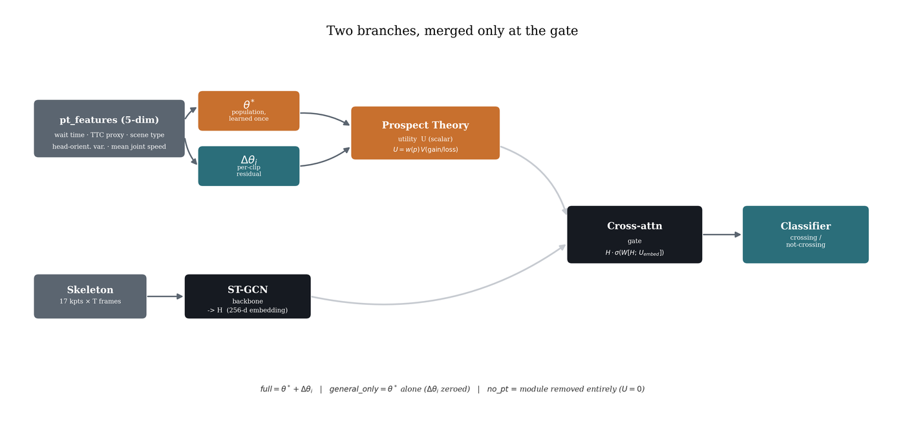
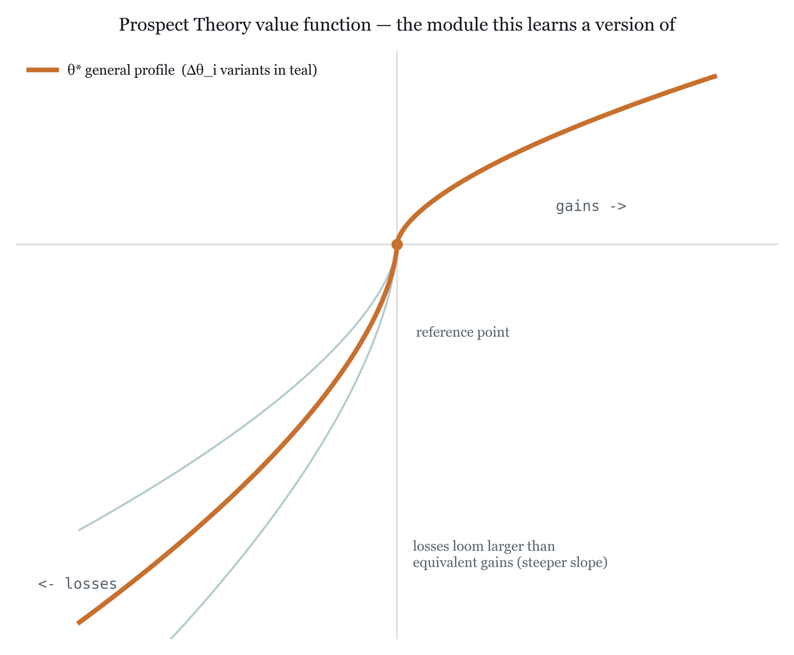
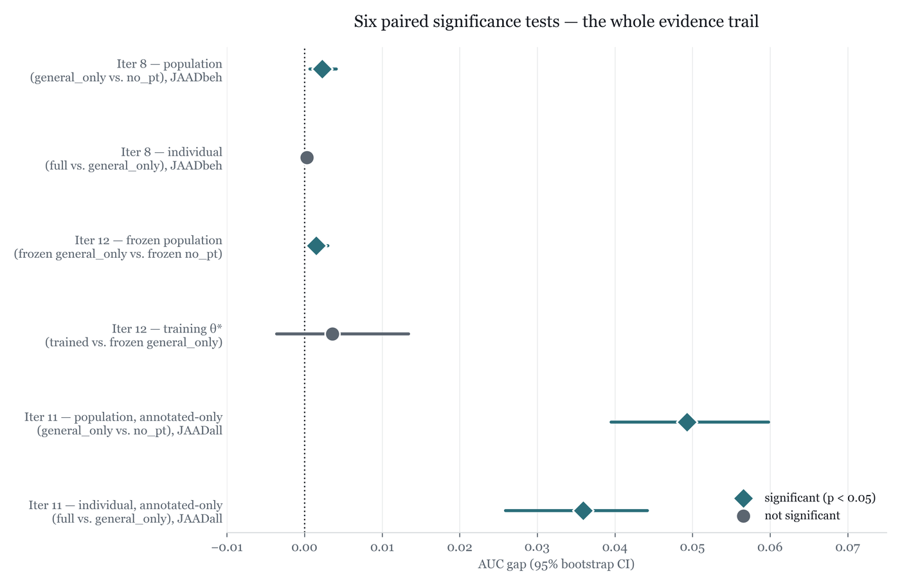
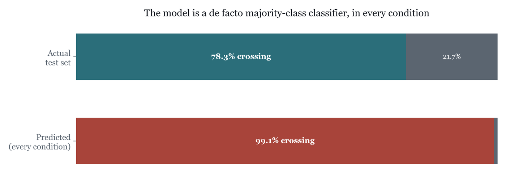
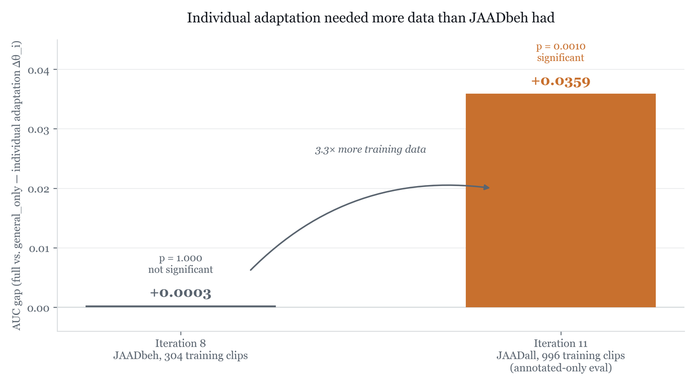

# Pedestrian Behaviour Prediction Based on Prospect Theory

MSc Data Science research project, University of Exeter.
**Author:** Taylor Xu · **Supervisor:** Dr Xingchen Zhang

Can a model of individual risk perception improve pedestrian crossing prediction?

Most crossing-prediction models treat a pedestrian as a deterministic function of the scene. Two people
facing the same gap in traffic can make opposite decisions, though, because they weigh risk differently.
This project adds a differentiable **Cumulative Prospect Theory** (Kahneman & Tversky, 1979; Tversky &
Kahneman, 1992) module to a skeleton-based ST-GCN crossing model, so the model can represent how risk
tolerance varies from person to person.



## How it works

The model uses a two-stage risk profile:

- **Population profile θ\*** = (α, β, λ, γ): learned once across all training pedestrians and initialised
  from the published literature values.
- **Individual adaptation Δθᵢ**: predicted per pedestrian from a short clip, so that θᵢ = θ\* + Δθᵢ.

The resulting Prospect Theory utility gates the 256-d ST-GCN skeleton embedding through a cross-attention
gate before classification (crossing / not crossing). Five behavioural features drive the Prospect Theory
branch: in-clip wait time, a time-to-collision proxy, scene type, head-orientation variance and mean
joint speed. Skeletons are re-extracted from the raw JAAD videos with ViTPose.



Three ablation conditions isolate each part of the model, each run across the same **12 fixed seeds**:

| Condition | What it tests |
|---|---|
| `full` | θ\* + Δθᵢ (population and individual) |
| `general_only` | θ\* only, with Δθᵢ zeroed |
| `no_pt` | Prospect Theory module removed |

## Results

| Comparison | Data | p-value | Significant |
|---|---|---|---|
| general_only vs. no_pt (population) | JAADbeh | 0.0015 | Yes |
| full vs. general_only (individual) | JAADbeh (304 training clips) | 1.000 | No |
| Frozen literature θ\* vs. no_pt (population) | JAADbeh | 0.0020 | Yes |
| Trained θ\* vs. frozen θ\* | JAADbeh | 0.8262 | No |
| general_only vs. no_pt (population) | JAADall, annotated-only | 0.0005 | Yes |
| full vs. general_only (individual) | JAADall, annotated-only (996 training clips) | 0.0010 | Yes |



- **Population level:** a modest but significant effect, which holds even when θ\* is frozen at its
  original 1979/1992 literature values.
- **Individual level:** no effect on JAADbeh, but significant on JAADall's larger, artifact-corrected
  subset (AUC +0.0359). This suggests the earlier null result was a data-volume limit rather than a
  broken mechanism.

### Two pitfalls this project ran into

1. **Majority-class collapse.** An early AUC gap looked like evidence for the method. A confusion-matrix
   check showed the model was predicting "crossing" for 99.1% of samples in every condition. The bias
   was corrected with three independent debiasing mechanisms before any of the results above were
   produced.

   

2. **Bystander artifact.** Most of JAADall's test set is unannotated bystanders, and a trivial wait-time
   feature almost solves the task on them. All headline JAADall numbers therefore use the annotated-only
   subset.

The individual-adaptation result needed about 3.3 times more data to appear:



**Limitations:** the effects are modest. JAADbeh and JAADall come from the same footage, so these
results don't show generalisation beyond JAAD; a cross-dataset check on PIE is the obvious next step.

## Repository structure

```
pedestrian_behaviour/
├── data/
│   ├── preprocess_jaad.py       Parse JAAD XML annotations into processed splits (JAADbeh / JAADall)
│   └── extract_skeletons.py     Re-extract skeletons with ViTPose (or OpenPose-equivalent CPM)
├── jaad_dataset.py              PyTorch Dataset for processed JAAD tracks
├── stgcn_backbone.py            ST-GCN skeleton encoder (adapted from ST CrossingPose)
├── prospect_theory.py           Two-stage Prospect Theory module: θ* plus adaptation network
├── pt_behaviour.py              Full model: backbone, Prospect Theory gate and classifier
├── train.py                     Training loop
├── evaluate.py                  Three-condition ablation evaluation
├── setup_and_run.ipynb          Step-by-step setup, training and evaluation commands
├── requirements.txt
└── docs/
    ├── TWELVE_SEED_TUNING_LOG.md   Chronological experiment log (iterations 1 to 10)
    ├── JAAD_PT_feasibility.md      Audit of JAAD annotations against the Prospect Theory inputs
    └── figures/
```

`docs/TWELVE_SEED_TUNING_LOG.md` is a running log of iterations 1 to 10, written as the experiments happened. Its early
"recommended" iteration was later shown to be the majority-class artifact described above; the results
table in this README reflects the final position.

## Quick start

```bash
pip install -r requirements.txt
git clone https://github.com/ykotseruba/JAAD
bash JAAD/download_clips.sh                      # ~3.1 GB of video

python data/preprocess_jaad.py --jaad_dir JAAD --output_dir data/processed_jaad

for split in train val test; do
  python data/extract_skeletons.py \
      --video_dir JAAD/JAAD_clips \
      --tracks_dir data/processed_jaad/$split \
      --output_dir data/processed_jaad/$split/skeletons_vitpose \
      --method vitpose --device cuda
done

python train.py --data_dir data/processed_jaad --dataset jaad --skeleton_src vitpose \
    --output_dir experiments/run_vitpose --epochs 100 --batch_size 32 --lr 1e-3 --device cuda

python evaluate.py --data_dir data/processed_jaad \
    --checkpoint experiments/run_vitpose/best_model.pt --skeleton_src vitpose --device cuda
```

See `setup_and_run.ipynb` for the full sequence, including the OpenPose comparison. A CUDA GPU is
recommended; the experiments were run on Google Colab.

## Data

The JAAD videos and annotations aren't included in this repository. They are published by Rasouli,
Kotseruba & Tsotsos (York University) under the MIT License:

- Annotations and data interface: [github.com/ykotseruba/JAAD](https://github.com/ykotseruba/JAAD)
- Dataset page: [data.nvision2.eecs.yorku.ca/JAAD_dataset](https://data.nvision2.eecs.yorku.ca/JAAD_dataset/)

JAADbeh (618 pedestrians with behavioural annotations) and JAADall (2,404 pedestrians, including
bystanders) both come from the same release. `data/preprocess_jaad.py` builds JAADbeh
(`sample_type='beh'`). The JAADall (iteration 11) and frozen-θ\* (iteration 12) experiments were run as
variants of this pipeline in Colab and are written up in the dissertation; that code isn't included here yet.

## Key references

- Kahneman, D. & Tversky, A. (1979). Prospect Theory: An Analysis of Decision under Risk. *Econometrica*.
- Tversky, A. & Kahneman, D. (1992). Advances in Prospect Theory. *Journal of Risk and Uncertainty*.
- Zhang, X., Angeloudis, P. & Demiris, Y. (2022). ST CrossingPose. *IEEE T-ITS*.
- Xu, Y. et al. (2022). ViTPose. *NeurIPS*.
- Rasouli, A., Kotseruba, I. & Tsotsos, J. (2017). JAAD. *ICCV Workshops*.
- Kotseruba, I., Rasouli, A. & Tsotsos, J. (2021). Benchmark for Evaluating Pedestrian Action Prediction. *WACV*.
